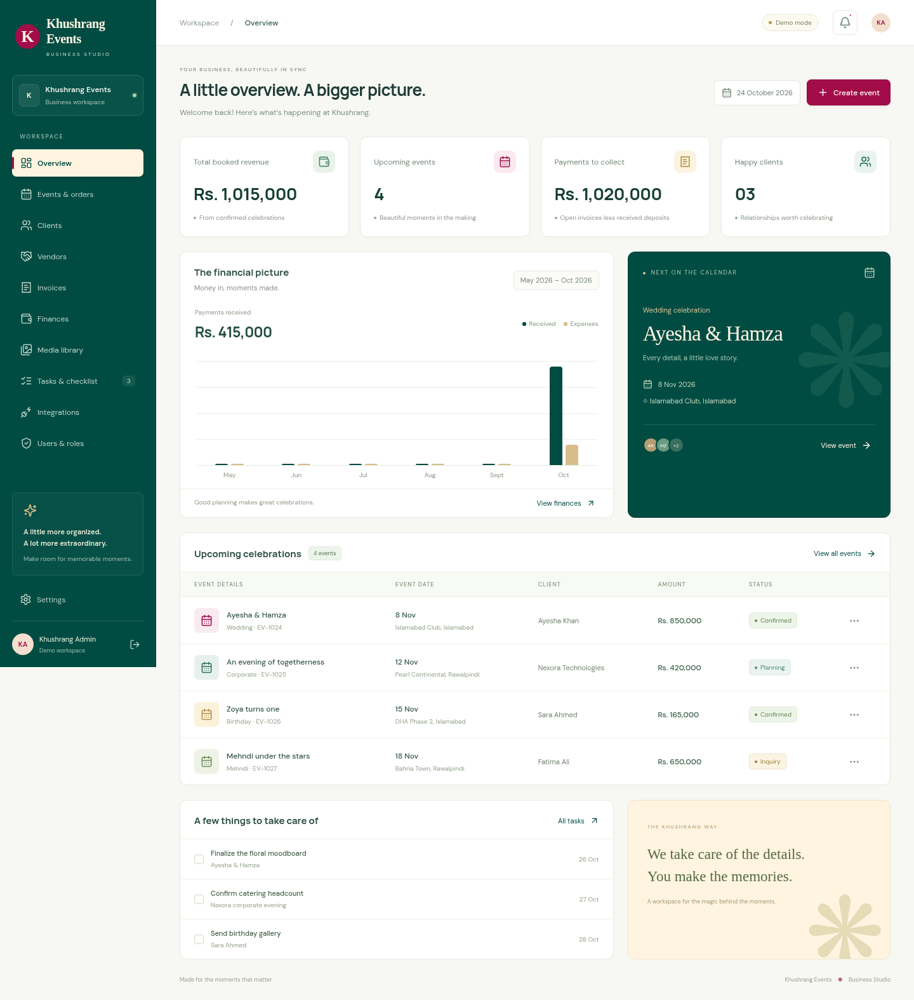
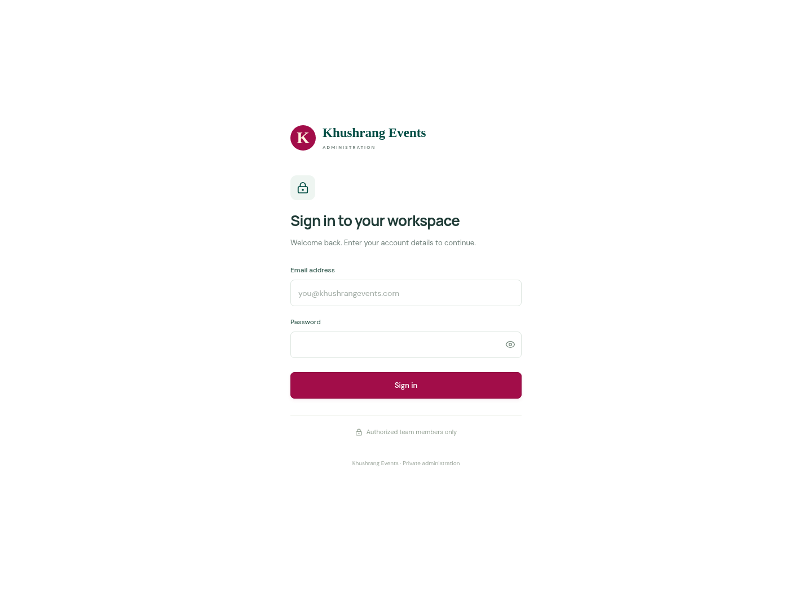
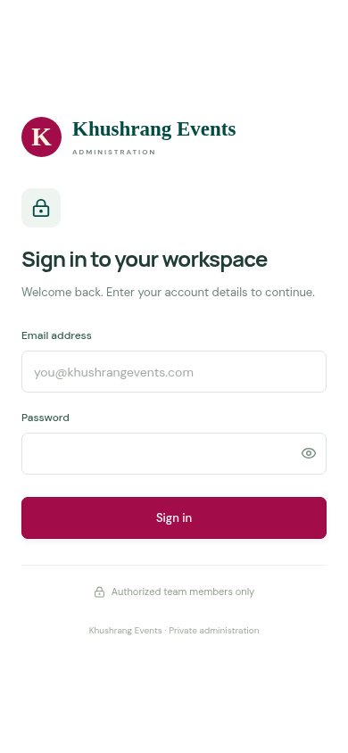
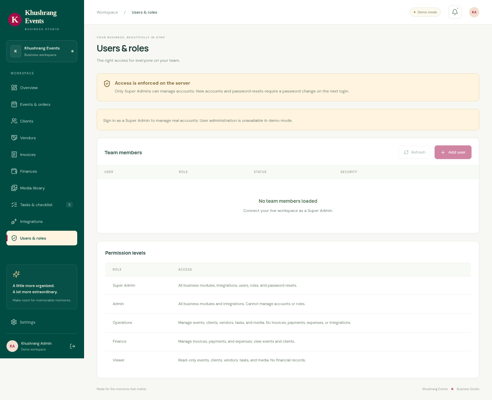
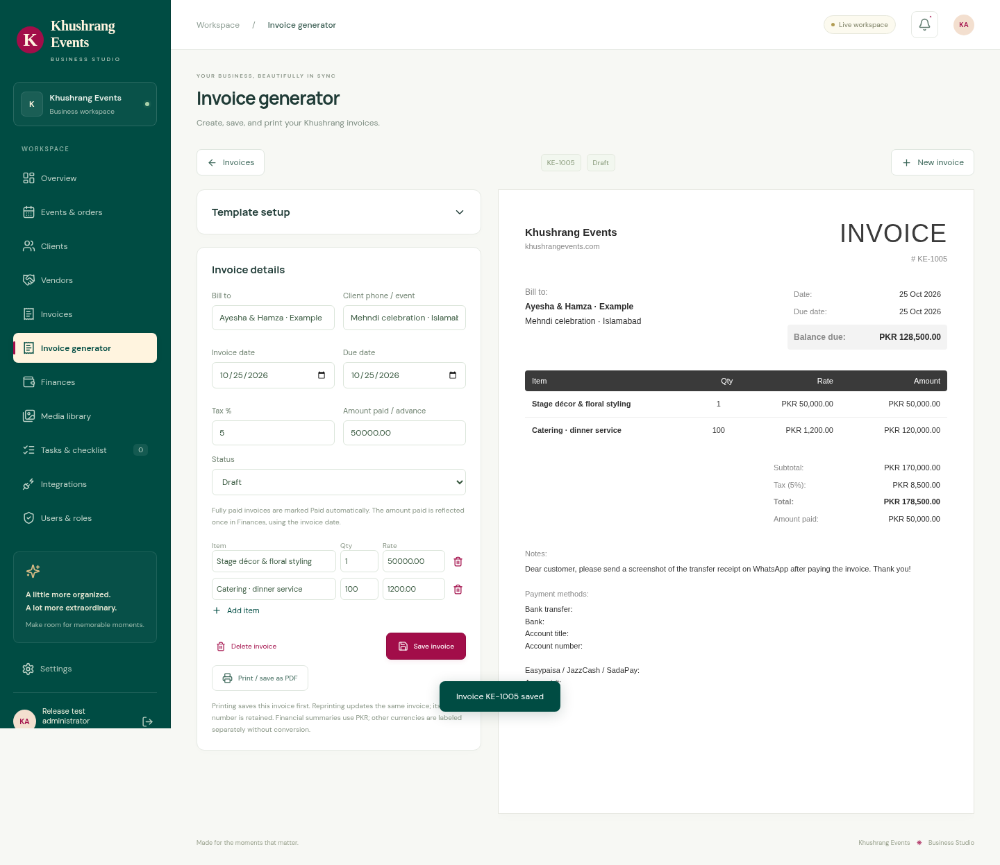
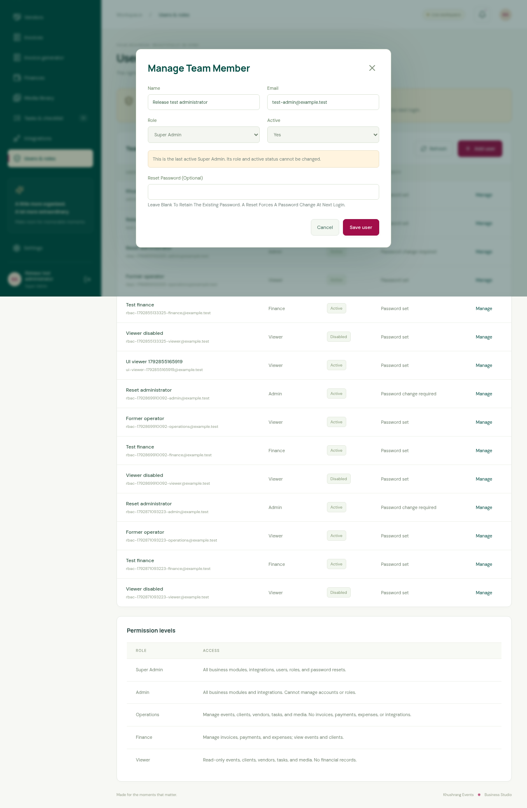
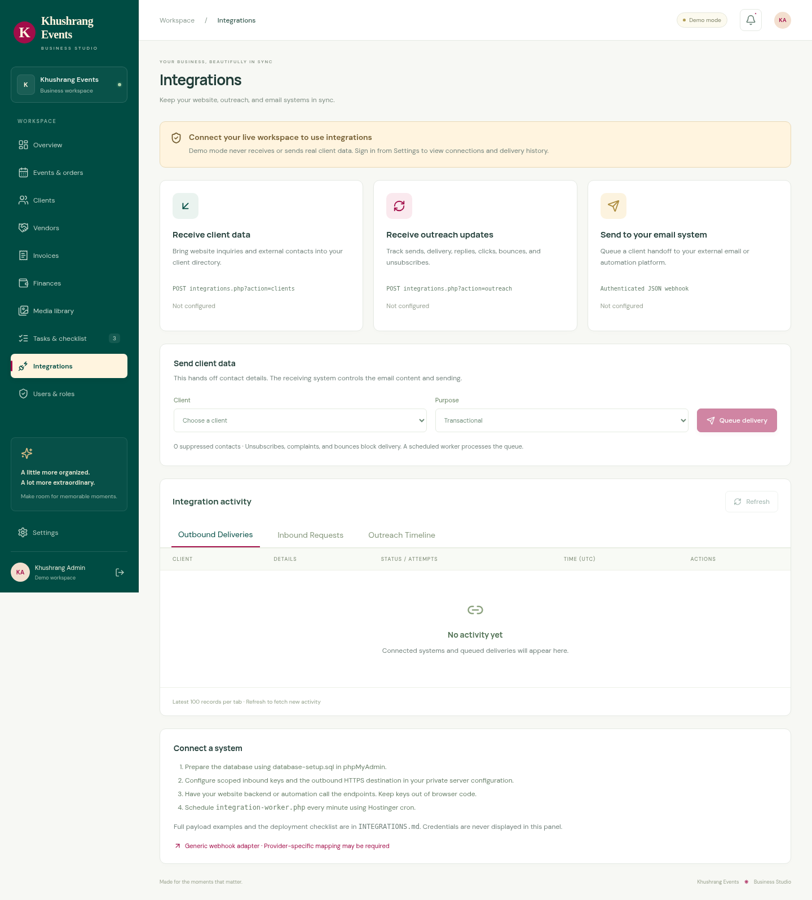
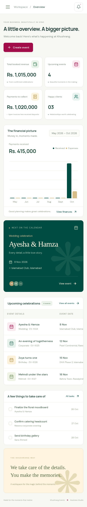

# Khushrang admin panel — UI preview

The login screenshots show the standalone white sign-in page. Portal screenshots show an authenticated, isolated sample database; no portal or demonstration is available before login. Click an image to open it at full size.

## Desktop dashboard

## Login

## Mobile login

## User management and permissions

## Integrated invoice generator

[Mobile generator](ui-review/invoice-generator-mobile.png) · [Example A4 invoice PDF](ui-review/invoice-example.pdf)

## Last Super Admin protection

## Integrations

## Mobile dashboard

The first live database starts empty. Screenshots are design previews, not imported business records. See [the release checklist](../RELEASE-REVIEW.md) and [deployment instructions](../README.md#hostinger-layout).
